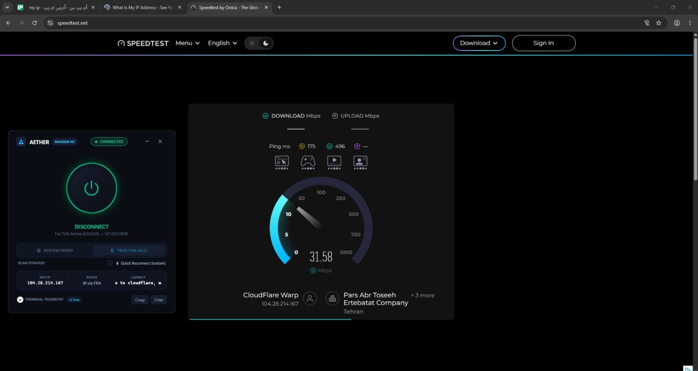

# ⚡ Cloudflare WARP (MASQUE Edition)

> Lightweight, high-performance native Windows client for **Cloudflare WARP** over **MASQUE HTTP/2 (RFC 9298)**, engineered for zero-DNS-leak censorship bypass on restricted networks (Iran TCI, MCI, Irancell).

<p align="center">
  
</p>

---

### ✨ Features

- **MASQUE HTTP/2 Protocol**: Routes Cloudflare WARP through `CONNECT-IP` (RFC 9298) over standard HTTP/2, completely bypassing UDP filtering and SNI blocks.
- **Dual Routing Architecture**:
  - 🛡️ **True TUN (Wintun)**: Full layer-3 kernel adapter tunneling all system TCP/UDP traffic and games, with automatic DNS anti-poisoning locked to `1.1.1.1`.
  - 🌐 **System Proxy (WinINET)**: Instant zero-overhead HTTP/HTTPS CONNECT proxy on `127.0.0.1:1820` for all Windows browsers (Brave, Chrome, Edge).
- **Smart Reconnection**: Sub-300ms instant reconnect using cached healthy edge gateways, with auto-fallback to turbo scanning across 2,000+ IP candidates.
- **Zero-Orphan Process Management**: Native Win32 Kernel Job Objects ensure clean teardown of child engines and routing tables on exit.
- **Fluent Cyber UI**: Hardware-accelerated WPF dark interface with pulsing radar animations and real-time telemetry.

---

### 🛡️ Why MASQUE Works Against Severe DPI & Censorship

National firewalls and ISP Deep Packet Inspection (DPI) engines employ three primary mechanisms to disrupt circumvention tools. MASQUE (RFC 9298) systematically neutralizes all three layers:

#### 1. Overcoming the UDP & WireGuard Deadlock
- **The Problem**: Standard Cloudflare WARP (the official 1.1.1.1 client) operates over UDP-based WireGuard. Restrictive ISPs enforce aggressive UDP rate-limiting, random packet dropping, and port blacklisting, rendering raw WireGuard unstable or completely blocked.
- **The MASQUE Solution**: MASQUE encapsulates the entire tunnel data plane into a reliable, connection-oriented **HTTP/2 (TCP) transport on standard TLS port 443**. ISPs cannot throttle or drop TCP port 443 without simultaneously breaking thousands of domestic financial, governmental, and commercial services hosted behind Cloudflare's Anycast CDN.

#### 2. Stealth via Standard Web Requests (`CONNECT-IP`)
- Rather than exposing identifiable VPN handshakes or protocol headers, the client establishes an authentic TLS session directly to Cloudflare's Anycast edge and issues a standardized proxy request:
  ```http
  CONNECT /.well-known/masque/ip/172.16.0.2/ HTTP/2
  Host: cloudflareaccess.com
  ```
- Cloudflare’s edge responds with `HTTP/2 200 OK`. From that moment onward, all bidirectional IP frames are multiplexed inside what appears to the DPI as an ordinary, encrypted HTTPS browsing stream. No identifiable VPN signatures or heuristic fingerprints are visible on the wire.

#### 3. Immune to DNS Poisoning (Zero-Leak Architecture)
- Restrictive ISPs routinely hijack and poison unencrypted UDP port 53 DNS queries, returning blackhole or filtering sinkhole IPs (e.g., `10.10.34.34`).
- In this client:
  - **In System Proxy Mode**: Browsers issue standard `CONNECT <domain>:443` requests directly to `127.0.0.1:1820`. Domain names are resolved remotely by Cloudflare's recursive resolvers inside the Frankfurt egress node—local DNS is never queried.
  - **In True TUN Mode**: The client automatically rebinds physical adapter DNS to `1.1.1.1` and tunnels all port 53 datagrams through the encrypted Wintun interface, completely isolating queries from ISP surveillance and spoofing.

---

### 🚀 Quick Start

1. Download the latest release from [Releases](https://github.com/ShiTmoZ/A/releases).
2. Extract the archive into a dedicated folder.
3. Run `AetherClient.exe` as **Administrator**.
4. Select your preferred mode (**True TUN** or **System Proxy**) and click **CONNECT**.

---

### 🛠️ Build from Source

```powershell
dotnet publish AetherClient\AetherClient.csproj -c Release -r win-x64 --self-contained true -p:PublishSingleFile=true -o .\publish
```
Place `aether.exe`, `wintun.dll`, `tun2socks.exe`, and `aether-masque.toml` alongside `AetherClient.exe`.
